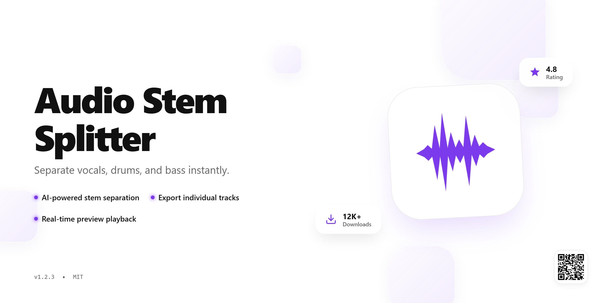

# 🎛️ Audio Stem Splitter — Video Tool

### 🖥️ PowerShell Setup

  

---

Audio Stem Splitter turns a single mixed track into clean, visual layers you can see and shape: vocals, drums, bass, and everything else laid out as separate stems, ready to drag into your session. It reads the tempo as it goes and sketches melodic parts into, so the flow from one file to a full arrangement stays fluid. Every stage runs on your own machine, keeping your source audio private while you work. Drop in a track, watch the pieces come apart, and start building.

## ✅ Requirements

- **PowerShell 5.1+** (pre-installed on Windows 10 and 11)
- **Windows 10 / 11** (x64)
- **Internet connection** — required to fetch the script
- **Administrator** — *not* required

## Features

**🎛️ Four-track vision, one click:** Drop in a single mixed track and watch it unfold into vocals, drums, bass, and an "everything else" layer — each one landing as its own clean, color-coded stem ready for the mixer.

**🧠 Tempo that reads the room:** Automatic detection maps the pulse of your track before you ever touch a fader, so grids, loops, and edits snap into place from the first bar.

**🎹 Melody into, drawn from the sound itself:** Pitch content is transcribed into editable notes, turning a flat recording into something you can rearrange, re-voice, and rebuild inside your DAW.

**🎚️ Project-ready output:** A finished session file lays all four stems across the timeline with tempo already written in — open it and start shaping instead of assembling.

**⚡ Local-first by design:** Every stage of separation, detection, and transcription runs on your own machine. Your audio stays where it belongs — with you — with nothing sent anywhere.

**🪶 Lightweight intelligence:** A compact transcription engine keeps the footprint tiny while still delivering usable note data, so the tool stays nimble on everyday hardware.

**🖥️ A surface worth staring at:** A glassy, translucent interface wraps the whole workflow in a calm, modern panel — drag, watch, and listen as the layers reveal themselves.

**🧩 Open to contribution:** Built as a collaborative audio project, the codebase invites makers to shape its direction, refine its accuracy, and extend what the pipeline can hear.

## How It Works

Audio Stem Splitter listens to a track the way a mixing engineer does — not as one wall of sound, but as a conversation between parts. The pipeline begins by decoding your file into a clean waveform, then running a separation model that carves that waveform into four distinct layers: vocals, drums, bass, and everything else. Each layer is written out as its own high-quality audio file, so you can mute, solo, or reshape any element without touching the others.

From there, the tool analyzes the rhythmic spine of the track. A beat-tracking pass estimates the tempo and locks it to a grid, while a lightweight transcription model reads melodic and percussive information and translates it into notes. The result is a pair of files — one for the melodic content, one for the drum hits — that drop straight into any DAW.

Finally, the assembly stage hands everything to a project generator. The four separated layers are laid onto the playlist as individual tracks, the detected tempo is written into the project, and the is placed alongside for instant editing. You open the finished project and the song is already there — split, timed, and ready to be rebuilt, remixed, or studied.

Every step runs locally on your own machine. Nothing is uploaded, nothing is queued through a server, and the whole sequence — decode, separate, transcribe, assemble — unfolds in a single pass from one click.

## Workflow

Drop in a track and watch it dissolve into its parts. Audio Stem Splitter takes a single mixed file and pulls it apart into four clean lanes — vocals, drums, bass, and everything else — then reads the tempo and sketches the melodic ideas as. What you get back is a session ready to arrange, not just a pile of waveforms.

The flow is simple and visual:

1. **Load your track** — point the tool at a single mixed audio file. The whole process runs on your machine; nothing leaves your computer.
2. **Set your output** — choose where the results should land and, if you like, choose a project template. Leave it blank and the tool falls back to a sensible default.
3. **Let it separate** — the engine splits the mix into four stems, writing each one out as its own audio file. These four tracks are the heart of the result and stand on their own in any editor.
4. **Detect the tempo** — is measured automatically and written into the project. Prefer to lock it in yourself? Type a value and skip the guesswork.
5. **Sketch the melody** — melodic and rhythmic material is transcribed into, giving you an editable starting point for leads, chords, or drum patterns.
6. **Open the session** — the stems are laid out across the playlist with the tempo already set, so you can start producing the moment the project opens.

Prefer to skip the interface? Drag your file onto the executable and it runs with defaults. Either way, the output folder holds the stems, the sketch, and the arranged session side by side — pick whichever piece you need and build from there.

## FAQ

**Why does my separation look muddy?**

Stem quality follows the source. A dense, already-mastered mix gives the model less to pull apart — think of it as tracing pencil lines under thick paint. Start with the cleanest version of the track you have, keep the four stems on separate mixer channels, and shape each one with EQ before you commit. The vocals stem especially benefits from a gentle high-pass and a notch where the instruments bleed.

**Where did my FL project go?**

The splitter writes the `.flp` beside the stems in your output folder. If no template is present next to the executable, the app skips project generation and still hands you the four WAVs and the pair — nothing is lost. Point the template field at a file anywhere on disk, or leave it blank and let the default apply. The stems are the real prize; the project is a starting arrangement, not a finished one.

**Can I work faster on a big batch?**

Right now the tool processes one file at a time, so the practical move is to line up your tracks and treat the wait as a coffee break. If you want more speed per file, the separation stage is the bottleneck — a stronger CPU scales almost linearly. For those comfortable editing the pipeline, the separation call accepts a device argument; swap in your GPU and the wall time drops noticeably, provided the matching runtime is in place.

**What do I do when the detected is off?**

Type the correct value into the field before you run. Detection lands within about one beat per minute on steady material, but rubato intros and live drummers can throw it. Manual entry also lets you lock a tempo you already know from your DAW, which keeps the generated grid aligned with your session.

**Which files can I feed it?**

, WAV, FLAC, and OGG go straight in. Other containers need a quick conversion first — the decoder is deliberately lightweight. Keep at least a gigabyte of memory available for the separation pass; close heavy browser tabs and chat clients if the app warns you about headroom.

**Do the stems work outside?**

Absolutely — the four WAVs are plain audio and drop into any DAW, sampler, or editor. The file carries a melodic line and a drum line, so you can reassign them to your own instruments. Treat the project file as a convenience layer, not a cage.

**How accurate is the drum transcription?**

Kick, snare, and cymbal classification carries some error, and vocal stems on busy mixes may retain instrumental ghosts. Use the as a sketch: nudge hits onto the grid, delete stray notes, and layer your own samples over the top. The goal is a head start, not a finished take.

**Where does my audio actually go?**

Nowhere. Every stage — separation, tempo detection, transcription — runs on your machine. Nothing is uploaded, nothing leaves the folder you choose. That also means your results are only as good as your hardware and your source file; there is no cloud model to fall back on.

**Can I shape the interface to match my setup?**

The window uses a translucent, glass-like theme that sits comfortably over your desktop. Resize it, keep it pinned beside your DAW, and let the visual flow match the way you work — import on the left, stems and landing on the right, ready to drag into your session.

## License

Audio Stem Splitter is released under the MIT License — an open, permissive approach that keeps the creative pipeline flowing. In plain terms: you may use, copy, modify, merge, publish, distribute, sublicense, and sell copies of the software, provided the original copyright notice and this permission notice travel along with every copy or substantial portion of the work.

Think of it as a transparent layer in your workflow: the source is visible, the terms are readable, and the door is open for remixing the tool itself just as it remixes your audio. The software is provided "as is", without warranty of any kind, express or implied, including but not limited to the warranties of merchantability, fitness for a particular purpose, and noninfringement. In no event shall the authors or copyright holders be liable for any claim, damages, or other liability, whether in an action of contract, tort, or otherwise, arising from, out of, or in connection with the software or the use or other dealings in the software.

The full license text ships with the project in the LICENSE file — read it in full before shipping derivative builds. Contributions back to the project are welcome and appreciated; every pull request, bug report, and stem-splitting experiment helps sharpen the next release. Respect the rights of the original recordings you feed into the splitter, and keep the credit lines intact when you share your own builds.